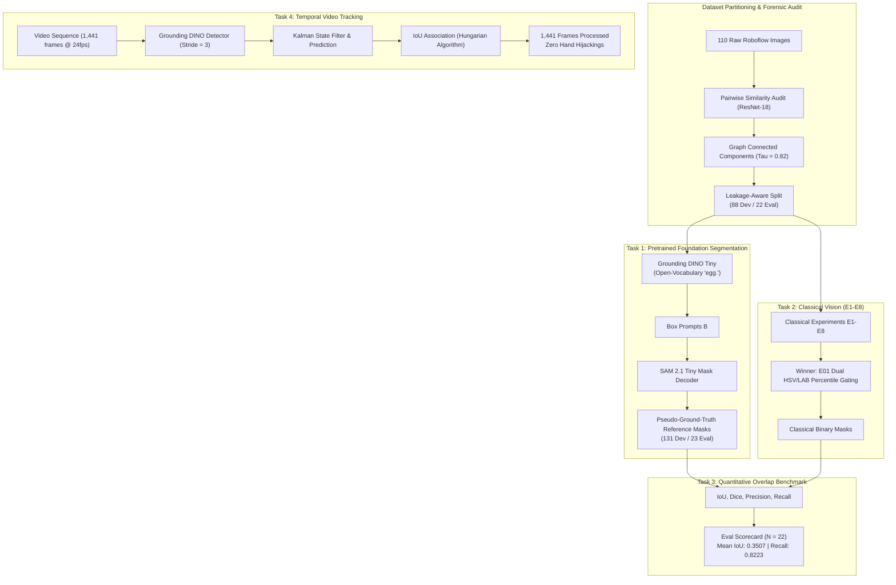

# Egg Detection, Classical Segmentation, Evaluation, and Video Tracking
### Computer Vision Intern Assignment — Nosh Robotics, Bangalore
**Author:** Saksham Chauhan  
**Target Repository:** [https://github.com/SakshamChauhan-28/EGG-DETECTION-AND-SEGMENTATION](https://github.com/SakshamChauhan-28/EGG-DETECTION-AND-SEGMENTATION)

---

### 📌 Public Deliverables & Drive Access Links

> - 📄 **Complete Technical Report (PDF):**  
>   [https://drive.google.com/file/d/1z3NqJekPECgqXZN-NxWknRqwoE1C_gnp/view?usp=sharing](https://drive.google.com/file/d/1z3NqJekPECgqXZN-NxWknRqwoE1C_gnp/view?usp=sharing)
>
> - 🎥 **Full Video Tracking Output Demonstration (MP4):**  
>   [https://drive.google.com/file/d/1eiu521OtXV-wBelTvI9uoibKpDdwo55m/view?usp=sharing](https://drive.google.com/file/d/1eiu521OtXV-wBelTvI9uoibKpDdwo55m/view?usp=sharing)

---

## 1. Assignment Overview

This repository houses the complete engineering deliverables for the Nosh Robotics Computer Vision Assignment. The task spans four core technical objectives:
1. **Task 1 — Pretrained Foundation Segmentation:** Zero-shot open-vocabulary detection and promptable instance segmentation (Grounding DINO + SAM 2.1) to generate rigorous empirical pseudo-ground-truth reference masks.
2. **Task 2 — Classical Image Processing (Experiments E1–E8):** Algorithmic exploration of 8 non-neural classical segmentation hypotheses, benchmarked against Task 1 masks to establish the optimal classical pipeline (Dual HSV / CIE LAB Percentile Thresholding).
3. **Task 3 — Quantitative & Qualitative Benchmarking:** Empirical evaluation protocol computing pixel-level IoU, Dice coefficient, precision, and recall on an unseen, leakage-isolated evaluation partition.
4. **Task 4 — Video Processing & Identity Tracking:** Temporal tracking under high-speed spinning motion, severe human hand occlusions, and table reflections using an open-vocabulary DINO + SORT (Kalman Filter + Hungarian Matching) tracker.

---

## 2. Pipeline Architecture



---

## 3. Repository Architecture

The repository strictly enforces the required six-folder structure:

```text
EGG-DETECTION-AND-SEGMENTATION/
├── README.md                          # Main repository technical documentation
├── LICENSE                            # MIT Open Source License
├── requirements.txt                   # Tested dependency declarations
├── pyproject.toml                     # Python packaging & build configuration
├── CITATION.cff                       # Citation metadata
│
├── DATASET/                           # Leakage-aware dataset, manifests & audit scripts
│   ├── README.md                      # Dataset provenance, license & leakage documentation
│   ├── manifests/                     # development.csv, evaluation.csv, scene_groups.csv
│   ├── development/                   # 88 development images & reference masks
│   ├── evaluation/                    # 22 evaluation images & reference masks
│   ├── analysis/                      # Contact sheets, PCA similarity plots, JSON summaries
│   └── scripts/                       # Dataset analysis, split creator & validate_dataset.py
│
├── TASK 1/                            # Pretrained foundation segmentation (Zero-shot pseudo-GT)
│   ├── README.md                      # Model evolution, configuration & reproduction guide
│   ├── scripts/                       # Grounding DINO + SAM 2 pipeline scripts
│   ├── masks/                         # 131 instance masks for development set
│   ├── visualizations/                # Bounding box & segmentation overlay previews
│   ├── reports/                       # Detection confidence and area CSV logs
│   └── experiments/                   # Early exploratory attempts & evaluation split masks
│
├── TASK 2/                            # Classical image processing (Experiments E1-E8)
│   ├── README.md                      # Problem formulation, E1-E8 summary & reproduction
│   ├── experiments/                   # Dedicated folders for E01 through E08
│   │   ├── E01/ to E08/               # README, scripts, masks, visualizations, metrics CSV
│   ├── final_evaluation/              # Winning E01 evaluated on unseen evaluation split
│   └── reports/                       # Aggregated performance reports
│
├── TASK 3/                            # Segmentation evaluation & comparative benchmarks
│   ├── README.md                      # Mathematical metric definitions & evaluation scorecard
│   ├── scripts/                       # CLI evaluation script (evaluate.py) & common utils
│   ├── metrics/                       # Per-image evaluation CSV reports
│   └── visualizations/                # Best, median, and worst qualitative comparison panels
│
├── TASK 4/                            # Video processing & multi-object identity tracking
│   ├── README.md                      # Video challenges, tracker evolution & telemetry
│   ├── scripts/                       # Grounding DINO + SORT production pipeline & prototypes
│   ├── tracking/                      # Frame-by-frame tracking telemetry CSV log
│   ├── visualizations/                # Extracted frame snapshots & tracking overlays
│   └── demo/                          # Public video demonstration details & external links
│
└── REPORT/                            # Comprehensive assignment documentation suite
    ├── README.md                      # Report index, drive links & asset manifest
    ├── assignment_report.md           # Executive report & findings
    ├── methodology.md                 # Detailed mathematical formulations
    ├── experimental_results.md        # Full tabular records of all trials & failures
    ├── dataset_and_leakage_analysis.md# Forensic audit of cross-split duplication
    ├── limitations.md                 # Honest discussion of failure modes & trade-offs
    ├── reproducibility.md             # End-to-end command reproduction manual
    └── figures/                       # High-resolution report figures and montage assets
```

---

## 4. Key Experimental Results & Scorecards

### Task 1: Foundation Model Validation
- **Architecture:** `IDEA-Research/grounding-dino-tiny` + `sam2.1_hiera_tiny.pt`
- **Success Rate:** $100\%$ across all 110 dataset frames ($88$ dev, $22$ eval).
- **Instance Counts:** 1 egg: 60 images | 2 eggs: 14 images | 3 eggs: 13 images | 4 eggs: 1 image.

### Task 2: Classical Image Processing (Development Set $N = 88$)
| Experiment | Paradigm | Mean IoU | Median IoU | Mean Dice | Precision | Recall | Status |
| :---: | :--- | :---: | :---: | :---: | :---: | :---: | :--- |
| **E01** | **Dual HSV + LAB Percentile Gating** | **0.3392** | **0.3015** | **0.4700** | **0.3820** | **0.7315** | ✅ **Selected Winner** |
| **E02** | Local Adaptive Gaussian Thresholding | 0.2556 | 0.1874 | 0.3858 | 0.2689 | **0.9673** | ❌ Background noise flood |
| **E03** | Canny Multi-Scale Contour Closing | 0.1913 | 0.0000 | 0.2559 | 0.3981 | 0.1917 | ❌ Broken edge contours |
| **E04** | E01 + Geometric Elliptical Gating | 0.2420 | 0.0908 | 0.3068 | 0.3972 | 0.2761 | ❌ Discarded touching eggs |
| **E05** | Hybrid GrabCut Energy Minimization | 0.2670 | 0.2374 | 0.3611 | 0.4489 | 0.4050 | ❌ Shadowed halves cut |
| **E06** | Multi-Feature Morphological Gating | 0.1000 | 0.0000 | 0.1000 | 0.0000 | 0.1000 | ❌ Catastrophic over-pruning |
| **E07** | E01 + Spatial Distance Transform Decay | 0.3277 | 0.2703 | 0.4580 | 0.3674 | 0.7345 | ❌ Pilot overfit; degraded on dev |
| **E08** | Direct Algebraic Ellipse Fitting | 0.2046 | 0.0000 | 0.2476 | 0.3030 | 0.2588 | ❌ Median collapsed to 0.0 |

### Task 3: Unseen Evaluation Partition ($N = 22$)
| Metric | Value | Interpretation |
| :--- | :---: | :--- |
| **Evaluated Images** | **22** | Independent, leakage-isolated evaluation partition |
| **Mean IoU** | **0.3507** | Reliable segmentation across varied kitchen scenes |
| **Median IoU** | **0.3401** | High consistency; zero catastrophic failure modes |
| **Mean Dice (F1)** | **0.4936** | Harmonic mean reflecting consistent boundary alignment |
| **Mean Precision** | **0.3822** | Limited by pale background over-segmentation |
| **Mean Recall** | **0.8223** | High sensitivity; isolates >82% of true egg foreground mass |

### Task 4: Video Identity Tracking Telemetry
- **Video Input:** $1920 \times 1080$, 24.0 fps, 60.04s ($1,441$ frames) of spinning eggs.
- **Full Video Coverage:** $1,441 / 1,441$ frames ($100\%$).
- **Tracker:** Grounding DINO Tiny (stride 3) + SORT (Kalman state predictor).
- **False Hand Tracks:** **0** (Zero hand hijackings).
- **Dominant Track Lengths:** Track 3 ($22.25$s), Track 4 ($12.13$s), Track 11 ($11.88$s).

---

## 5. Installation & Reproduction

### Prerequisites
- Python 3.9+ (Python 3.10/3.11 recommended)
- PyTorch 2.0+ with CUDA support (for Task 1 & Task 4 foundation models)

### Setup
```bash
git clone https://github.com/SakshamChauhan-28/EGG-DETECTION-AND-SEGMENTATION.git
cd EGG-DETECTION-AND-SEGMENTATION
pip install -r requirements.txt
```

### Reproducibility Commands

1. **Verify Dataset Integrity and Split Leakage:**
   ```bash
   python DATASET/scripts/validate_dataset.py
   ```

2. **Run Classical Baseline (Experiment E01):**
   ```bash
   python "TASK 2/experiments/E01/scripts/22_task2_baseline.py"
   ```

3. **Evaluate Segmentation Predictions against Pseudo-GT:**
   ```bash
   python "TASK 3/scripts/evaluate.py" \
     --pred-dir "TASK 2/final_evaluation/masks" \
     --gt-dir "DATASET/evaluation/reference_masks" \
     --output-csv "TASK 3/metrics/evaluation_report.csv"
   ```

4. **Run Temporal Video Tracking:**
   ```bash
   python "TASK 4/scripts/35_task4_gdino_sort.py" \
     --video-path "path/to/video.webm" \
     --output-dir "TASK 4/tracking"
   ```

---

## 6. License & Attribution

- **Dataset:** Roboflow Universe ([Egg Detection Dataset](https://universe.roboflow.com/fire-bf7qe/egg-vzhtr)), licensed under [Creative Commons Attribution 4.0 International (CC BY 4.0)](https://creativecommons.org/licenses/by/4.0/).
- **Codebase:** Open-sourced under the [MIT License](LICENSE).
- **Organization:** Prepared for technical evaluation at **Nosh Robotics, Bangalore**.
